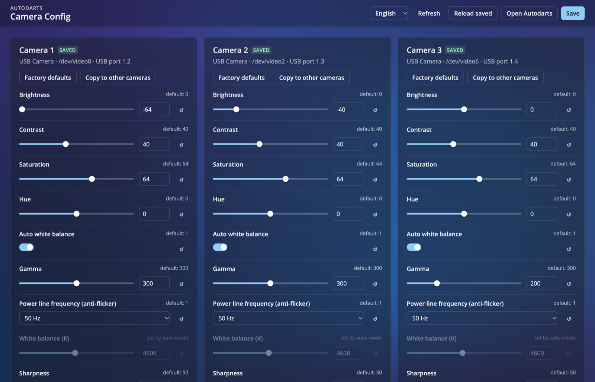

# Autodarts Camera Config

**Web-basierter Kamera-Konfigurator für headless [Autodarts](https://autodarts.io)-Boards.**

[🇬🇧 English](README.md) · 🇩🇪 Deutsch · [🇭🇺 Magyar](README.hu.md)

Wenn Autodarts headless auf einem Raspberry Pi (oder einem anderen Linux-Rechner) läuft, heißt Kameraeinstellen normalerweise: per SSH einloggen und `v4l2-ctl --set-ctrl=...`-Befehle tippen. Nach jedem Neustart sind die Werte wieder weg. Dieses Tool bietet eine kleine Webseite mit Schiebereglern für jede Kameraeinstellung. Es merkt sich die Werte und stellt sie nach einem Neustart automatisch wieder her.



## Funktionen

- **Eine Karte pro Kamera** mit Schiebereglern, Schaltern und Auswahllisten für Helligkeit, Kontrast, Sättigung, Farbton, Gamma, Schärfe, Weißabgleich, Belichtung, Netzfrequenz (gegen Flimmern) und alle weiteren Regler, die die Kamera anbietet.
- **Live**: Jede Änderung wird sofort übernommen, das Ergebnis siehst du direkt in der Autodarts-Oberfläche. Ein Button öffnet sie in einem neuen Tab.
- **Dauerhaft**: Nach *Speichern* werden die Einstellungen nach jedem Neustart und beim erneuten Anstecken einer Kamera automatisch wieder gesetzt.
- **Stabile Kamera-Zuordnung über den USB-Port**: Die Einstellungen bleiben bei der richtigen Kamera, auch wenn sich die `/dev/videoX`-Nummern ändern.
- **Auf andere Kameras kopieren**: eine Kamera einstellen und die Werte mit einem Klick auf die anderen übertragen.
- **Werkseinstellungen** pro Kamera und ein Reset-Button pro Regler.
- **Oberfläche auf Englisch, Deutsch und Ungarisch**. Die Sprache wird automatisch erkannt und lässt sich oben umschalten.
- Gleiches Aussehen wie die Autodarts-Oberfläche.
- **Keine Abhängigkeiten** außer `python3` und `v4l-utils`: eine einzige Python-Datei, nur Standardbibliothek. Autodarts selbst wird nicht verändert.

## Voraussetzungen

- Autodarts auf einem Linux-Rechner mit systemd. Getestet auf Raspberry Pi OS / Debian 12 (bookworm), Raspberry Pi 4.
- USB-Kameras (UVC).
- `sudo`-Rechte auf diesem Rechner.

## Installation

Per SSH auf dem Autodarts-Rechner einloggen und ausführen:

```bash
curl -fsSL https://raw.githubusercontent.com/czdanika/autodarts-camera-config/main/install.sh | bash
```

Danach im Browser eines beliebigen Geräts im Netzwerk **`http://<ip-deines-pi>:8088`** öffnen.

Das Installationsskript:
1. installiert `python3` und `v4l-utils`, falls sie fehlen,
2. kopiert `camctl.py` nach `/opt/autodarts-camera-config`,
3. übernimmt die Schrift Open Sans aus der lokalen Autodarts-Oberfläche, damit die Seite auch ohne Internet richtig aussieht,
4. legt den systemd-Dienst `autodarts-camera-config` an und startet ihn.

### Optionen

```bash
# anderer Port
curl -fsSL https://raw.githubusercontent.com/czdanika/autodarts-camera-config/main/install.sh | CAMCTL_PORT=9000 bash
```

### Manuelle Installation

```bash
git clone https://github.com/czdanika/autodarts-camera-config.git
cd autodarts-camera-config
./install.sh
```

Oder zum schnellen Testen ohne Dienst:

```bash
sudo apt install v4l-utils
python3 camctl.py          # → http://<pi-ip>:8088
```

## Benutzung

1. Die Autodarts-Oberfläche (`http://<pi-ip>:3180`) neben der Konfigurationsseite öffnen, um die Kamerabilder zu sehen.
2. Die Regler verschieben, bis das Bild gut aussieht. Typische Verbesserungen:
   - **Netzfrequenz**: in Europa **50 Hz**, in Nordamerika **60 Hz**. Das verhindert Flimmern unter LED-Licht.
   - **Belichtungsmodus → Manuell** mit fester **Belichtungszeit** ergibt unter einem LED-Ring ein stabiles Bild. Die automatische Belichtung neigt zum „Pumpen“.
   - **Helligkeit / Kontrast / Gamma** und **Schärfe**, damit sich die Darts gut vom Board abheben.
3. **Auf andere Kameras kopieren**, wenn alle Kameras dasselbe Modell sind.
4. **Speichern** klicken. Ab jetzt werden die Einstellungen etwa 45 Sekunden nach jedem Start und beim erneuten Anstecken einer Kamera gesetzt.

**Gespeicherte laden** setzt alle Kameras auf den zuletzt gespeicherten Stand zurück, zum Beispiel nach missglückten Experimenten.

## Tipp: stabile Kamerapfade in Autodarts

Fällt eine Kamera kurz vom USB ab (Wackelkontakt, Spannungseinbruch), vergibt Linux eine **neue** Nummer, z. B. wird `/dev/video4` zu `/dev/video6`. Autodarts zeigt dann für diese Kamera ein schwarzes Bild und die Kalibrierung schlägt fehl. Abhilfe: statt `/dev/videoX` die stabilen, USB-Port-basierten Pfade eintragen:

```bash
ls /dev/v4l/by-path/ | grep usb | grep index0     # eine Zeile pro Kamera
sudo systemctl stop autodarts
cp ~/.config/autodarts/config.toml ~/.config/autodarts/config.toml.bak
nano ~/.config/autodarts/config.toml               # Zeile  cams = [...]  unter [cam] anpassen
sudo systemctl start autodarts
```

```toml
[cam]
cams = ["/dev/v4l/by-path/…-usb-0:1.2:1.0-video-index0", "/dev/v4l/by-path/…-usb-0:1.3:1.0-video-index0", "/dev/v4l/by-path/…-usb-0:1.4:1.0-video-index0"]
```

Die Reihenfolge der Kameras beibehalten und jede Kamera im selben USB-Port lassen. Diese Kamera-Konfiguration erkennt die Kameras bereits über den USB-Port.

## Aktualisieren

Den Installationsbefehl einfach erneut ausführen. Die gespeicherten Einstellungen bleiben erhalten.

## Deinstallieren

```bash
curl -fsSL https://raw.githubusercontent.com/czdanika/autodarts-camera-config/main/uninstall.sh | bash
# mit  -s -- --purge  werden auch die gespeicherten Einstellungen gelöscht:
curl -fsSL https://raw.githubusercontent.com/czdanika/autodarts-camera-config/main/uninstall.sh | bash -s -- --purge
```

## Fehlerbehebung

| Problem | Lösung |
|---|---|
| Seite lädt nicht | `systemctl status autodarts-camera-config` und `journalctl -u autodarts-camera-config -n 50` |
| „Keine USB-Kameras gefunden“ | `v4l2-ctl --list-devices` prüfen. Es werden nur USB-Kameras (uvcvideo) angezeigt. Mit `CAMCTL_ALL=1` erscheinen alle Capture-Geräte. |
| Ein Regler ist ausgegraut | Er wird von einer Automatik gesteuert. Zuerst z. B. *Automatischer Weißabgleich* ausschalten oder *Belichtungsmodus* auf *Manuell* stellen. |
| „Fehlgeschlagen: … Permission denied“ | Der Dienst-Benutzer muss in der Gruppe `video` sein. Das Installationsskript fügt ihn hinzu. Nach manueller Installation einmal neu starten. |
| Einstellungen nach Neustart weg | Wurde **Speichern** geklickt? Die Datei liegt unter `/opt/autodarts-camera-config/settings.json`. |

## Konfiguration

Umgebungsvariablen, im systemd-Dienst setzen mit `sudo systemctl edit autodarts-camera-config`:

| Variable | Standard | Bedeutung |
|---|---|---|
| `CAMCTL_PORT` | `8088` | Web-Port |
| `CAMCTL_CONF` | `settings.json` neben dem Skript | Speicherort der Einstellungen |
| `CAMCTL_APPLY_DELAY` | `45` | Sekunden nach dem Start, bevor gespeicherte Werte gesetzt werden |
| `CAMCTL_ALL` | – | `1` = alle Capture-Geräte anzeigen, nicht nur USB-Kameras |

## Sicherheitshinweis

Die Seite hat kein Login. Jeder im lokalen Netzwerk, der die Adresse kennt, kann die Kameraeinstellungen ändern. Port 8088 nicht ins Internet freigeben.

## Haftungsausschluss

Inoffizielles Community-Tool, nicht mit Autodarts verbunden oder von Autodarts unterstützt. Es ändert nur Kameraeinstellungen über die Standard-Linux-Schnittstelle V4L2. Dateien oder die Konfiguration von Autodarts werden nie verändert.

## Lizenz

[MIT](LICENSE)
