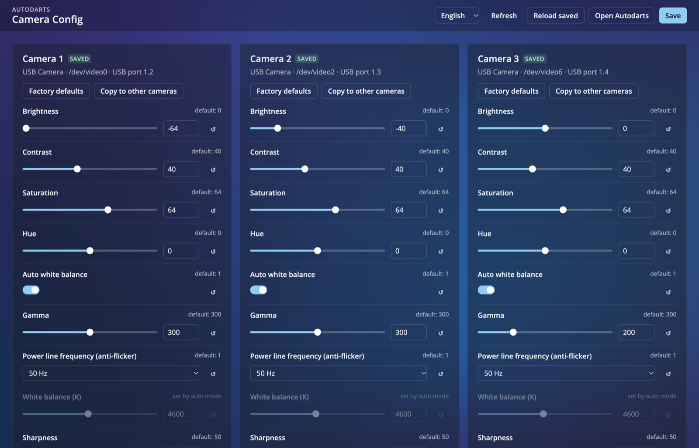

# Autodarts Camera Config

**Webes kamerakonfigurátor headless [Autodarts](https://autodarts.io) táblákhoz.**

[🇬🇧 English](README.md) · [🇩🇪 Deutsch](README.de.md) · 🇭🇺 Magyar

Ha az Autodarts headless fut egy Raspberry Pi-n (vagy más linuxos gépen), a kamerák beállításához általában SSH-n kell belépni és `v4l2-ctl --set-ctrl=...` parancsokat gépelni, a beállított értékek pedig újraindításkor elvesznek. Ez az eszköz egy kis weboldalt ad, ahol minden kamerabeállítás csúszkával állítható, és az értékeket újraindítás után is visszaállítja.



## Funkciók

- **Kameránként egy kártya** csúszkákkal, kapcsolókkal és legördülő listákkal. Állítható a fényerő, a kontraszt, a szaturáció, a színárnyalat, a gamma, az élesség, a fehéregyensúly, az expozíció, a hálózati frekvencia (villódzás ellen), és minden más, amit a kamera tud.
- **Élő állítás**: minden változás azonnal érvényesül, így az Autodarts felületén rögtön látod az eredményt. Egy gomb új lapon meg is nyitja.
- **Megmarad**: a *Mentés* után a beállításokat minden újraindításkor, és ha egy kamera újracsatlakozik, magától visszaállítja.
- **USB-port alapú azonosítás**: a beállítás akkor is a megfelelő kamerához kerül, ha a `/dev/videoX` sorszámok megváltoznak.
- **Másolás a többi kamerára**: egy kamerát beállítasz, és egy kattintással átmásolod az értékeit a többire.
- **Gyári értékek** kameránként, és minden beállításnál egy visszaállító gomb.
- **Angol, német és magyar felület**. A nyelvet a böngésző alapján választja ki, és fent át lehet váltani.
- Ugyanúgy néz ki, mint az Autodarts felülete.
- **Nincs más függősége**, csak a `python3` és a `v4l-utils`: egyetlen Python-fájl, csak a standard könyvtárat használja. Magát az Autodarts-ot nem módosítja.

## Követelmények

- Linuxos gépen (systemd-vel) futó Autodarts. Raspberry Pi OS / Debian 12 (bookworm) rendszeren, Raspberry Pi 4-en tesztelve.
- USB (UVC) kamerák.
- `sudo` jog a gépen.

## Telepítés

Lépj be SSH-val az Autodarts-ot futtató gépre, és futtasd:

```bash
curl -fsSL https://raw.githubusercontent.com/czdanika/autodarts-camera-config/main/install.sh | bash
```

Ezután a hálózat bármelyik eszközén nyisd meg böngészőben: **`http://<a-pi-ip-címe>:8088`**

A telepítő:
1. feltelepíti a `python3`-at és a `v4l-utils`-t, ha hiányoznak,
2. a `camctl.py`-t a `/opt/autodarts-camera-config` mappába másolja,
3. a helyi Autodarts felületről átveszi az Open Sans betűtípust, így az oldal internet nélkül is jól néz ki,
4. létrehozza és elindítja az `autodarts-camera-config` systemd service-t.

### Beállítások

```bash
# másik port
curl -fsSL https://raw.githubusercontent.com/czdanika/autodarts-camera-config/main/install.sh | CAMCTL_PORT=9000 bash
```

### Kézi telepítés

```bash
git clone https://github.com/czdanika/autodarts-camera-config.git
cd autodarts-camera-config
./install.sh
```

Vagy gyors kipróbáláshoz, service nélkül:

```bash
sudo apt install v4l-utils
python3 camctl.py          # → http://<pi-ip>:8088
```

## Használat

1. Nyisd meg mellette az Autodarts felületét (`http://<pi-ip>:3180`), hogy lásd a kameraképeket.
2. Állítsd a csúszkákat, amíg jó nem lesz a kép. Ezek szoktak a legtöbbet javítani:
   - **Hálózati frekvencia**: Európában **50 Hz**, Észak-Amerikában **60 Hz**. Ez megszünteti a villódzást LED-es világítás alatt.
   - **Expozíció mód → Manuális**, fix **expozíciós idővel**. LED-gyűrű alatt így stabil lesz a kép, az automata expozíció hajlamos „pumpálni”.
   - **Fényerő / kontraszt / gamma** és **élesség**, hogy a nyilak jól elváljanak a táblától.
3. Ha egyforma kamerák vannak, használd a **Másolás a többi kamerára** gombot.
4. Kattints a **Mentés** gombra. Ezután a beállításokat minden indulás után kb. 45 másodperccel, és a kamerák újracsatlakozásakor is visszaállítja.

A **Mentett visszatöltése** gomb minden kamerát a legutóbb mentett állapotra állít vissza, például ha kísérletezés közben elállítottál valamit.

## Frissítés

Futtasd újra a telepítő parancsot. A mentett beállítások megmaradnak.

## Eltávolítás

```bash
curl -fsSL https://raw.githubusercontent.com/czdanika/autodarts-camera-config/main/uninstall.sh | bash
# ha a mentett beállításokat is törölnéd, add hozzá:  -s -- --purge
curl -fsSL https://raw.githubusercontent.com/czdanika/autodarts-camera-config/main/uninstall.sh | bash -s -- --purge
```

## Hibaelhárítás

| Probléma | Megoldás |
|---|---|
| Nem tölt be az oldal | `systemctl status autodarts-camera-config` és `journalctl -u autodarts-camera-config -n 50` |
| „Nem találok USB kamerát” | Nézd meg a `v4l2-ctl --list-devices` kimenetét. Csak az USB (uvcvideo) kamerák jelennek meg, `CAMCTL_ALL=1`-gyel minden capture eszköz. |
| Egy csúszka szürke | Azt egy automata mód vezérli. Előbb kapcsold ki pl. az *Automatikus fehéregyensúly*-t, vagy állítsd az *Expozíció mód*-ot *Manuális*-ra. |
| „Nem sikerült: … Permission denied” | A service felhasználójának benne kell lennie a `video` csoportban. A telepítő hozzáadja, kézi telepítésnél indítsd újra egyszer a gépet. |
| Újraindítás után elvesznek a beállítások | Megnyomtad a **Mentés** gombot? A beállításokat a `/opt/autodarts-camera-config/settings.json` fájl tárolja. |

## Konfiguráció

Környezeti változók, a systemd service-ben állíthatók: `sudo systemctl edit autodarts-camera-config`

| Változó | Alapérték | Jelentés |
|---|---|---|
| `CAMCTL_PORT` | `8088` | Webes port |
| `CAMCTL_CONF` | `settings.json` a script mellett | A mentett beállítások helye |
| `CAMCTL_APPLY_DELAY` | `45` | Indulás után ennyi másodperccel állítja vissza a mentett értékeket |
| `CAMCTL_ALL` | – | `1` = minden capture eszközt mutat, nem csak az USB kamerákat |

## Biztonság

Az oldalon nincs bejelentkezés. A helyi hálózaton bárki átállíthatja a kamerákat, aki ismeri a címet. A 8088-as portot ne nyisd ki az internet felé.

## Jogi nyilatkozat

Nem hivatalos, közösségi eszköz, nem kapcsolódik az Autodarts-hoz, és az Autodarts nem támogatja. Csak a kamerák beállításait módosítja, a szabványos Linux V4L2 felületen keresztül. Az Autodarts fájljaihoz és beállításaihoz nem nyúl.

## Licenc

[MIT](LICENSE)
