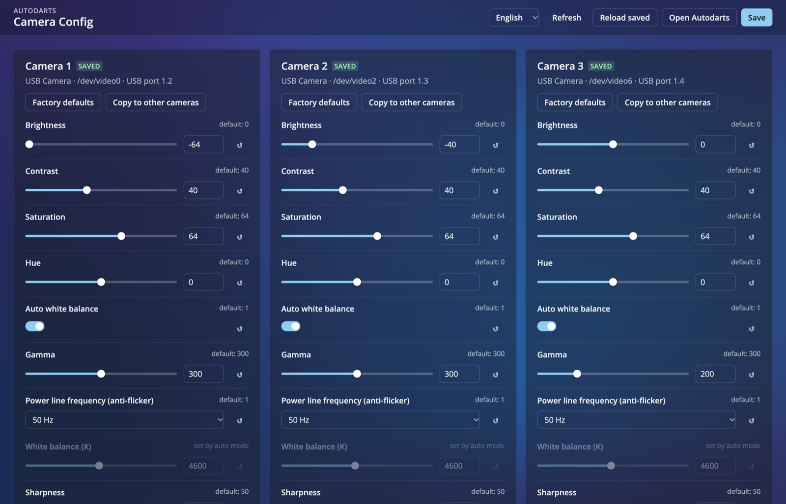

# Autodarts Camera Config

**A web-based camera configurator for headless [Autodarts](https://autodarts.io) boards.**

🇬🇧 English · [🇩🇪 Deutsch](README.de.md) · [🇭🇺 Magyar](README.hu.md)

If your Autodarts runs headless on a Raspberry Pi (or any Linux box), adjusting the cameras usually means SSH-ing in and typing `v4l2-ctl --set-ctrl=...` commands, and the values are lost after every reboot. This tool gives you a small web page with sliders for every camera setting. It remembers your values and applies them again after a reboot.



## Features

- **One card per camera** with sliders, switches and drop-downs for brightness, contrast, saturation, hue, gamma, sharpness, white balance, exposure, power-line frequency (anti-flicker) and any other control your camera exposes.
- **Live**: every change is applied immediately, so you can watch the result in the Autodarts UI. A button opens it in a new tab.
- **Persistent**: hit *Save* and the settings are re-applied automatically after a reboot or when a camera is re-plugged.
- **Stable camera identification by USB port**, so the settings stay with the right camera even if `/dev/videoX` numbers change.
- **Copy to other cameras**: tune one camera, then copy its settings to the other cameras with one click.
- **Factory defaults** per camera, and a reset button per setting.
- **English, German and Hungarian UI**. The language is detected from your browser and can be switched in the header.
- Same look as the Autodarts UI.
- **No dependencies** beyond `python3` and `v4l-utils`: a single Python file using only the standard library. It does not touch Autodarts itself.

## Requirements

- Autodarts running on a Linux machine with systemd. Tested on Raspberry Pi OS / Debian 12 (bookworm), Raspberry Pi 4.
- USB (UVC) cameras.
- `sudo` rights on that machine.

## Installation

SSH into the machine that runs Autodarts and run:

```bash
curl -fsSL https://raw.githubusercontent.com/czdanika/autodarts-camera-config/main/install.sh | bash
```

Then open **`http://<ip-of-your-pi>:8088`** in a browser on any device in your network.

The installer:
1. installs `python3` and `v4l-utils` if they are missing,
2. copies `camctl.py` to `/opt/autodarts-camera-config`,
3. copies the Open Sans font from your local Autodarts UI, so the page looks right without internet access,
4. creates and starts the systemd service `autodarts-camera-config`.

### Options

```bash
# use a different port
curl -fsSL https://raw.githubusercontent.com/czdanika/autodarts-camera-config/main/install.sh | CAMCTL_PORT=9000 bash
```

### Manual installation

```bash
git clone https://github.com/czdanika/autodarts-camera-config.git
cd autodarts-camera-config
./install.sh
```

Or run it without a service, for a quick test:

```bash
sudo apt install v4l-utils
python3 camctl.py          # → http://<pi-ip>:8088
```

## Usage

1. Open the Autodarts UI (`http://<pi-ip>:3180`) next to the camera config page, so you can see the camera images.
2. Move the sliders until the image looks good. Typical improvements:
   - **Power line frequency**: set it to **50 Hz** in Europe and **60 Hz** in North America. This removes flicker under LED lights.
   - **Exposure mode → Manual** with a fixed **exposure time** gives a stable image under a LED ring. Auto exposure tends to pump.
   - **Brightness / contrast / gamma** and **sharpness** to make the darts stand out from the board.
3. Use **Copy to other cameras** if all cameras are the same model.
4. Click **Save**. From now on, the settings are applied about 45 seconds after every boot and whenever a camera is re-plugged.

**Reload saved** puts all cameras back to the last saved state, for example if you made a mess while experimenting.

## Tip: stable camera paths in Autodarts

If a camera briefly drops off USB (loose cable, power glitch), Linux gives it a **new** number, e.g. `/dev/video4` becomes `/dev/video6`. Autodarts then shows a black image for that camera and calibration fails. To avoid this, point Autodarts at the stable, USB-port based paths instead of `/dev/videoX`:

```bash
ls /dev/v4l/by-path/ | grep usb | grep index0     # one line per camera
sudo systemctl stop autodarts
cp ~/.config/autodarts/config.toml ~/.config/autodarts/config.toml.bak
nano ~/.config/autodarts/config.toml               # edit the  cams = [...]  line under [cam]
sudo systemctl start autodarts
```

```toml
[cam]
cams = ["/dev/v4l/by-path/…-usb-0:1.2:1.0-video-index0", "/dev/v4l/by-path/…-usb-0:1.3:1.0-video-index0", "/dev/v4l/by-path/…-usb-0:1.4:1.0-video-index0"]
```

Keep the cameras in the same order as before, and keep each camera plugged into the same USB port. This Camera Config tool already identifies cameras by USB port.

## Updating

Run the install command again. Your saved settings are kept.

## Uninstalling

```bash
curl -fsSL https://raw.githubusercontent.com/czdanika/autodarts-camera-config/main/uninstall.sh | bash
# add  -s -- --purge  to also delete the saved settings:
curl -fsSL https://raw.githubusercontent.com/czdanika/autodarts-camera-config/main/uninstall.sh | bash -s -- --purge
```

## Troubleshooting

| Problem | Fix |
|---|---|
| Page does not load | `systemctl status autodarts-camera-config` and `journalctl -u autodarts-camera-config -n 50` |
| "No USB cameras found" | Check `v4l2-ctl --list-devices`. Only USB (uvcvideo) cameras are listed. Start with `CAMCTL_ALL=1` to list every capture device. |
| A slider is greyed out | It is controlled by an automatic mode. Switch off e.g. *Auto white balance* or set *Exposure mode* to *Manual* first. |
| "Failed: … Permission denied" | The service user must be in the `video` group. The installer adds it. Reboot once if you installed manually. |
| Settings are lost after reboot | Did you click **Save**? The file is `/opt/autodarts-camera-config/settings.json`. |

## Configuration

Environment variables, set in the systemd unit with `sudo systemctl edit autodarts-camera-config`:

| Variable | Default | Meaning |
|---|---|---|
| `CAMCTL_PORT` | `8088` | Web port |
| `CAMCTL_CONF` | `settings.json` next to the script | Where saved settings are stored |
| `CAMCTL_APPLY_DELAY` | `45` | Seconds to wait after start before applying saved settings |
| `CAMCTL_ALL` | – | `1` = list every capture device, not only USB cameras |

## Security note

The page has no login. Anyone on your local network who knows the address can change the camera settings. Do not expose port 8088 to the internet.

## Disclaimer

This is an unofficial community tool. It is not affiliated with or endorsed by Autodarts. It only changes camera settings through the standard Linux V4L2 interface. It never modifies Autodarts files or its configuration.

## License

[MIT](LICENSE)
